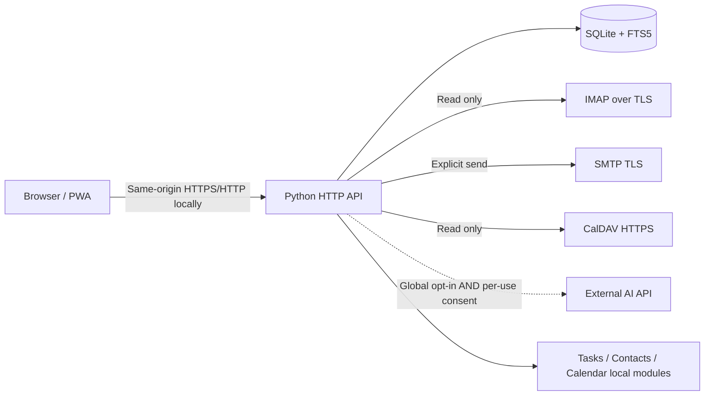

# AVENIQ

**Mail · Calendar · People · Tasks. Communication, without complexity.**

A calm, self-hosted foundation for a modern Outlook alternative. **No forced cloud account. No advertisements. No automatic AI.** Designed as an independent original codebase, with optional protocol connectors.

> **Release:** `v0.1.0` · local single-user developer preview · October 2026. This is **not feature parity with Microsoft Outlook** and is **not production-hardened SaaS**. The complete Outlook-replacement specification and user-feedback-driven feature register are in [`docs/PRODUCT_SPEC.md`](docs/PRODUCT_SPEC.md) and [`docs/FEATURE_MATRIX.md`](docs/FEATURE_MATRIX.md). Never claim a planned item is already implemented.

## Product vision

AVENIQ solves seven recurring pain points reported by Outlook users: too much UI clutter, fragmented mail/calendar/tasks, inconsistent behavior between versions, slow or unreliable search, hidden synchronization state, difficulty handling multiple accounts, and unclear control over data and AI. These reports are design signals, **not statistically representative survey results**. The original deep research is summarized and critically qualified in [`docs/RESEARCH.md`](docs/RESEARCH.md).

## Current, runnable features

| Function | Status | Important limitation |
|---|---|---|
| Local account creation, authentication and sessions | Working | One admin per installation; no MFA/SSO yet |
| Responsive dark/light workspace | Working | Desktop/PWA; no native desktop build yet |
| Multiple IMAP/SMTP account definitions | Working | Secrets only via environment; password/app-password auth, not OAuth |
| Real IMAP inbox retrieval | Working | Manual INBOX snapshot, last 150 UIDs; no full sync / IMAP flags write-back |
| Search all locally indexed mail | Working | SQLite FTS5; plaintext only |
| Plaintext message viewer with no remote pixels | Working | HTML and most attachment content deliberately not rendered |
| Local star / read / archive state | Working | Local-only, not IMAP mirrored |
| Compose and edit drafts | Working | No rich-text editor or attachments |
| Individual SMTP delivery with explicit confirmation | Working | Account credentials required; no undo after SMTP acceptance |
| Contacts / to-do items | Working | Local CRUD, not yet CardDAV/VTODO sync |
| Month calendar / local events / ICS import and export | Working | Narrow UTC/all-day ICS subset; recurrent exceptions and TZID unsupported |
| CalDAV calendar import | Partial | HTTPS read-only collection PROPFIND+GET; complex ICS skipped |
| Optional external AI for message summarization, reply ideas, task extraction | Working | OFF by default, global opt-in **and per-request checkbox**; no automatic sending or saving |
| Progressive web app shell | Partial | Shell cached, sensitive APIs not cached; not offline-first data sync |
| Audit activity list | Partial | Selected actions only; not a legal/compliance-grade audit system |
| Automated HTTP + unit tests | Working | No provider live-integration tests without credentials |

## Start locally

Requires Python **3.12+**, SQLite FTS5 (bundled in standard Python builds), and a modern browser. No pip or npm packages are required for this preview.

```bash
git clone https://github.com/rinats-png/Aveniq.git
cd aveniq
python3 -m aveniq
```

Open **http://127.0.0.1:8768**. Register the first (and only) administrator. The SQLite file will be created under `./data/aveniq.db` and ignored by Git.

### Try it without giving the app your email password

After account setup, open **Einstellungen → Demo-Posteingang laden**. Four explicitly fictional messages are created locally. Create contacts, tasks, drafts, calendar events; inspect the UI. No external mail, calendar or AI connections are made.

### Optional: connect a real IMAP/SMTP mailbox

1. Choose a provider that offers IMAPS on port 993 and SMTP with mandatory TLS on 465/587, using a dedicated app-password or credential. Microsoft 365 / many modern enterprise setups require OAuth2: **not yet supported**.
2. Set the username and password in the **server environment**, not in the browser or Git:

```bash
export AVENIQ_ACCOUNT_WORK_USER='me@example.org'
export AVENIQ_ACCOUNT_WORK_PASSWORD='your-app-password'
python3 -m aveniq
```

3. In **Einstellungen → Mailkonto einrichten**, fill in account address, IMAP/SMTP hostnames, and prefix `AVENIQ_ACCOUNT_WORK`. This stores only the prefix and server configuration.
4. Press **Abrufen** to import recent INBOX mail. The import is read-only. Clicking **Verfassen** saves a draft; **Entwürfe → Jetzt senden** requires an additional deliberate confirmation and a configured account.

**Important:** Standard SMTP and IMAP connectors do not mean Microsoft Graph, Outlook.com OAuth or Exchange shared-mailbox parity. See [`docs/INTEGRATIONS.md`](docs/INTEGRATIONS.md).

### Optional: CalDAV calendar

Configure `AVENIQ_CAL_TEAM_USER` / `AVENIQ_CAL_TEAM_PASSWORD` in the server environment. Create a calendar and set a direct HTTPS CalDAV **calendar collection URL**, e.g. a verified Nextcloud calendar URL, along with prefix `AVENIQ_CAL_TEAM`. Click its refresh icon. The adapter **only imports** individual UTC-based/calendar-day VEVENT files; it does **not** push changes to the CalDAV server. Local calendar creation and editing are separate.

### Optional: AI (disabled by default)

```bash
export AVENIQ_OPENAI_API_KEY='your-secret-key'
export AVENIQ_OPENAI_MODEL='gpt-4.1-mini'
python3 -m aveniq
```

Then explicitly enable it in **Einstellungen**. On a specific message, click a named AI action, read the disclosure and check the **single-use consent box**. Only that selected plain message text is sent to the external provider through HTTPS. There is no autonomous inbox scanning, autonomous draft creation, automatic storage, or automatic transmission of an email. A secret in the environment does **not** enable AI on its own.

## Run tests

```bash
python3 -m unittest discover -v
python3 -m compileall -q aveniq
node --check web/app.js   # optional Node 18+
```

The included GitHub Actions workflow runs unit/integration tests and JavaScript syntax checking. Local integration tests use an ephemeral HTTP port and **do not contact email or AI providers**.

## Docker local-only setup

```bash
cp .env.example .env
# Add only the optional credentials that you need.
docker compose up --build -d
```

Open `http://127.0.0.1:8768`. Compose publishes on `127.0.0.1` only, not to the public internet; it sets an explicit acknowledgment to support first-run setup inside its container network. Never change it to a public bind without an HTTPS reverse proxy, stronger authentication, explicit CSRF/origin configuration and a security review. See [`SECURITY.md`](SECURITY.md).

## Architecture



The system is deliberately small and dependency-light to maximize inspectability and make it easy to import into Codex. **Future architecture** should split authenticated API, durable sync workers, migration layer, OAuth broker, token vault, event index and permission boundaries. Recommended building blocks and licenses are in [`docs/SOURCES_AND_LICENSES.md`](docs/SOURCES_AND_LICENSES.md).

## Contents

```text
aveniq/
├── aveniq/
│   ├── db.py             SQLite schema, FTS5 and transactional access
│   ├── security.py       Auth helpers, validation, CSRF/session
│   ├── mail.py           Read-only IMAP importer + explicit SMTP delivery
│   ├── calendar.py       ICS basic import/export + read-only CalDAV adapter
│   ├── ai.py             Explicit AI consent gateway
│   └── server.py         API and static frontend hosting
├── web/                  Responsive mail/calendar/tasks UI, PWA shell
├── tests/                Unit and local HTTP integration tests
├── docs/                 Product research, feature matrix, plans, architecture
├── .github/workflows/    CI
├── Dockerfile / compose.yaml
├── .env.example
└── AGENTS.md              Coding-agent instructions and completion rules
```

## Outlook scope and honest limitations

The product specification covers classic Outlook, new Outlook, Outlook Web and mobile capabilities across mail, calendar, contacts, tasks, rules, offline sync, search, permissions, multi-account access, meeting scheduling, accessibility, security, AI and enterprise administration. **Covering a requirement in documentation is not equivalent to implementing it.**

The initial implementation consciously does **not** replicate PST/OST files, Exchange delegation, Microsoft Graph/OAuth2, Microsoft Teams, IMAP IDLE, push, true offline mail access, attachment downloading, MIME rich display, crypto key management, recurrence exceptions, meeting invites/RSVP, advanced rule engines, multiple users or organization governance. These require real development and test fixtures, not just UI placeholders.

## Commercial reuse and legal

New AVENIQ code is MIT licensed. External projects are *not copied into this repository* and their own licensing terms apply. Particularly, a fork of Roundcube (GPL) or SnappyMail (AGPL) cannot simply be relabeled MIT. FullCalendar **Standard** is MIT, its Premium suite is separately licensed. Live production requires license and security verification at selected release versions.

The AVENIQ name is selected for this project but **not a cleared trademark**, not a registered or cleared trademark. Some similarly named real-world businesses exist. Conduct DPMA/EUIPO and domain/trademark checks before product launch.
