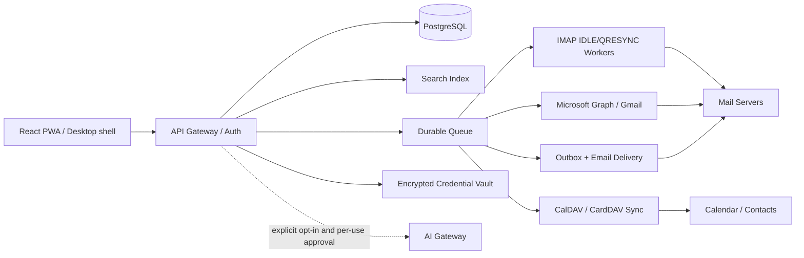

# Architektur / ADR-001: neuer modularer Mail-Client

## Entscheidung

**v0.1:** Ein einzelner Python-Standardbibliothek-Server, SQLite FTS5 und eine autonome Vanilla-JavaScript-Web-App. Originalcode unter MIT; externe Bibliotheken und Server als klar abgegrenzte Optionen. Dieses Design ist ideal zur lokalen Evaluation und für Codex als nachvollziehbarer Ausgangspunkt, nicht als unveränderliche finale SaaS-Architektur.

**Für v1:** PostgreSQL, React/TypeScript frontend, ein auth-basiertes API-Gateway, separat isolierte Sync-Worker, Eventbus/Queue, Secret Vault, per-account IMAP/SMTP/JMAP/Graph/DAV-Adapter, FTS-Suchdienst und Workflows für Persistenz.

## Key boundaries

1. **Source adapters are untrusted** — reject unexpected XML/MIME, bounded concurrency and byte limits, no private-IP SSRF from browser-provided URLs, DNS recheck and security-scoped outbound allowlist in production.
2. **Credential broker** — owns refresh tokens and secrets; UI only holds a narrow session; no tokens in JS/localStorage/IndexedDB.
3. **Sync workers** — use `(provider/account, folder, UIDVALIDITY, UID)` identity, QRESYNC/MODSEQ when supported; conflict records and immutable mailbox sync logs; separate inbound/outbound queues.
4. **Outbox** — state machine `draft → scheduled/cancellable → inflight → sent/unknown/error` with immutable attempt IDs; never blindly retry `unknown`.
5. **Search** — local/offline index where appropriate; provider search optional, deterministic filters; avoid logging search contents.
6. **Calendar** — native time-zone semantics (floating, UTC, TZID, local-day), RRULE/RDATE/EXDATE/RECURRENCE-ID and RSVP state; use RFC 5545 library before bidirectional write-back.
7. **AI** — capability-scoped opt-in (`summary`, `reply_suggestion`, `schedule_suggestion`); explicit user disclosure at the point of use; never auto-approve side effects.
8. **Extensions** — signed manifests, per-plugin permissions, isolated execution, no implicit access to other accounts. The initial code does *not* implement a plugin sandbox.

## Alternatives

| Path | Pros | Cons | Verdict |
|---|---|---|---|
| Fork Thunderbird | Proven mail, PGP, calendar, desktop | Huge C++/Gecko codebase, MPL boundary, difficult independent PWA | Good if product is desktop-first, not our current choice |
| Combine Roundcube + Radicale | Mature IMAP / DAV backend, faster for self-hosted groupware | PHP/GPL + Python/GPL, UI integration, ownership friction | Good *external* services, not a single unified new core |
| Original product + protocol libraries | UI freedom, clean boundaries, own user journeys | Sync, recurrence, security and enterprise parity are serious ongoing engineering work | **Selected**, with explicit phases |

## Git strategy

- `main` protected; feature branches, CI green, code review for mail/auth/calendar/AI changes.
- Every new shipped feature must have one test proving a successful flow and one proving rejection/failure (see `AGENTS.md`).
- Future migration from SQLite requires import/export and automatic schema migration, not implicit data loss.
